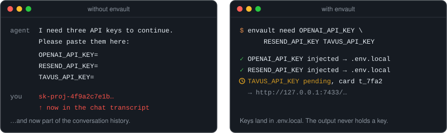
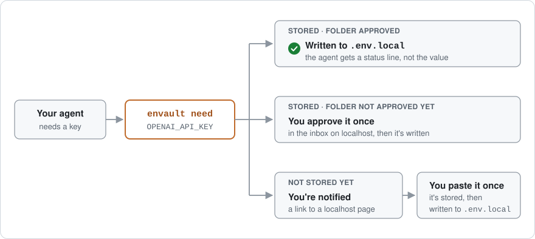
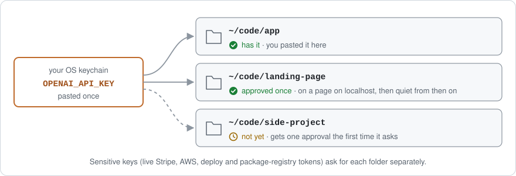
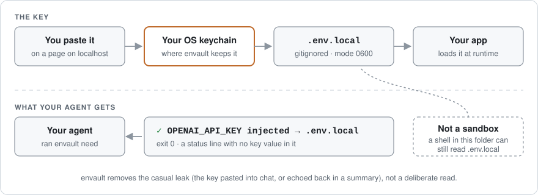

<h1 align="center">envault</h1>

<p align="center">
  <strong>Your AI agent needs your API keys. It doesn't need to see them.</strong>
</p>

<p align="center">
  Ask Claude Code, Codex or Cursor to build anything that calls an API, and it stops to ask you to paste a key into the chat. Once you paste it, the key sits in the transcript, the session summary and the model's context. With envault, the agent runs one command instead. The key goes straight into your project's <code>.env.local</code>, and the agent sees only <code>✓ OPENAI_API_KEY injected</code>.
</p>

<p align="center">
  Paste each key once, in your browser. Every project after that gets it with one click.<br>
  Works with Claude Code, Codex, Cursor and Gemini CLI. One Rust binary on your machine, with no account, no cloud service and no telemetry.
</p>

<p align="center">
  <a href="https://github.com/pekkaiscool/envault/releases/latest"><strong>Download</strong></a> ·
  <a href="SECURITY.md"><strong>Security</strong></a> ·
  <a href="CHANGELOG.md"><strong>Changelog</strong></a>
</p>

<p align="center">
  <a href="https://github.com/pekkaiscool/envault/actions/workflows/ci.yml"></a>
  
  
  
  
</p>

<p align="center">
  
</p>

## Install

```bash
brew install pekkaiscool/envault/envault
# or
npm install -g envault
# or
uv tool install envault
```

Then run this once:

```bash
envault init
```

`init` picks your OS keychain, the password store your system already has (Keychain on macOS, a Secret Service such as GNOME Keyring on Linux). Then it installs the envault skill for each agent it finds: Claude Code, Codex, Gemini CLI and Cursor. A skill is a short instruction file that an agent loads only when a task needs it, so envault adds nothing to your `AGENTS.md` or `CLAUDE.md`. envault runs on macOS and Linux. Windows is not supported yet.

<details>
<summary><strong>Other ways to install</strong></summary>

```bash
bun add -g envault
pnpm add -g envault
pipx install envault
cargo install --locked --git https://github.com/pekkaiscool/envault envault
```

Prebuilt binaries for macOS (Apple Silicon, Intel) and Linux (x64, arm64, static, any distribution) are on the [latest release](https://github.com/pekkaiscool/envault/releases/latest). Each comes with a sha256 file and a build attestation, a signed record of which workflow built it, that you can check with `gh attestation verify envault-<platform>.tar.gz --repo pekkaiscool/envault`. The npm and PyPI packages carry the same binary and run no install scripts.

</details>

## How it works

<p align="center">
  
</p>

When code needs a key, the agent runs `envault need OPENAI_API_KEY`. One of three things happens:

- **You have the key, and this folder is approved.** envault writes it to `.env.local`, and the agent carries on.
- **You have the key, but this folder hasn't asked for it before.** You get a notification that opens a card in your inbox. The inbox is a page envault serves only on your own machine, and a card is one request waiting for your answer. It shows exactly which keys go into which file, and you approve once.
- **You don't have the key yet.** The card links to the provider's sign-up page and lists the steps to create a key. You paste the key on the card once, and envault keeps it in your OS keychain for every project after.

<p align="center">
  
</p>

- **Approval is per folder, and you choose how wide it goes.** The first time a folder asks for keys you already have, the card offers three answers. **Allow these** covers only the listed keys. **Allow these + any non-sensitive key here** also covers keys envault knows and rates as non-sensitive, now and later. **Deny** says no, and envault remembers that for 24 hours by default.
- **Sensitive keys always ask.** Live Stripe secret keys, AWS credentials, deploy and package-registry tokens, and any key envault doesn't recognise get their own approval in each folder. The broad answer never covers them.
- **Local secrets are generated, not asked for.** envault creates `AUTH_SECRET`, `JWT_SECRET`, `SESSION_SECRET` and similar values itself, one per folder.
- **Keys are re-checked with the provider.** When a provider's check is safe to run unattended, envault asks the provider whether the key still works before it hands the key over, at most once a day by default. A rejected key becomes a Replace card, so you paste a new one before your code gets a 401, the error a provider returns for a bad key. A key whose check is not safe to run unattended is checked only when you paste it. If the provider can't be reached, the key goes out unchecked.

## Where your key goes

<p align="center">
  
</p>

The value travels from the card you paste it on, to your OS keychain, to the project's `.env.local`. envault makes that file readable only by you (mode `0600`) and adds it to `.gitignore`. `need` answers the agent with an exit code and a line like `✓ OPENAI_API_KEY injected → .env.local`, never the value. Delivering a key puts nothing into the chat, a summary or the conversation history. Every commit runs [`scripts/leak-test.sh`](scripts/leak-test.sh), which drives the real binary with a fake canary key and fails if the canary shows up anywhere it checks.

Your app loads `.env.local` the way it already does. Next.js and similar frameworks read it on their own. For anything else, use your runtime's dotenv support, the usual library for loading an env file, or start the program with `envault run --`.

**It is not a sandbox.** An agent with a shell in an approved folder can still read `.env.local`, just as it could without envault. Anything you type into a card's note or answer field also goes back to the agent as text. What envault removes is the everyday leak, the key pasted into chat or echoed back in a summary. The details are under [Security details](#more) below and in [SECURITY.md](SECURITY.md).

## Using it

After `init`, every agent session sees one line that describes the envault skill. The full instructions load only when code needs a key. They cover how to request a key, what each result means, and how to debug envault itself. You never need a terminal, because every decision happens on a card in your browser. You can still run the CLI yourself:

```bash
envault need OPENAI_API_KEY RESEND_API_KEY   # write the keys you have; ask for the rest
envault run -- npm run dev                   # load .env.local, and ask for a key the program says is missing
envault open                                 # the inbox: everything waiting on you
envault doctor                               # check the setup
```

### Automatic, or only when you ask

By default the agent loads the skill on its own when code needs a key. All it carries into each session is the skill's one-line description. If you would rather nothing happen until you ask, run this:

```bash
envault init --mode explicit
```

This installs the same skill, marked so that only you can start it. You type `/envault OPENAI_API_KEY` in Claude Code and Cursor, or `$envault` in Codex. Gemini CLI reads the same skill as Codex and asks you before it loads any skill. Typed on its own, `/envault` requests whatever the current task needs, and it covers the rest of that task, so a key the work needs later goes through it too. The value still goes to `.env.local` and never into the chat. In a session where you don't invoke it, Claude Code, Cursor and Codex do not see envault at all, and the agent asks you for keys the way it always did. `envault init --mode auto` switches back, `doctor` shows the mode, and `init --undo` removes either.

### MCP, if you want it

MCP (Model Context Protocol) is the standard way agents plug in outside tools. Agents that prefer it can have it too. `envault init --mcp` also registers envault as an MCP server with each agent (automatic mode only), and `--no-mcp` takes it out again. Earlier versions registered the server and wrote a section into `~/.codex/AGENTS.md` by default. `init` now takes both out unless you ask for the server.

## Working on another computer

The inbox runs on the machine where envault runs, at `127.0.0.1`, so its links open only on that machine. If you reach the machine over Tailscale, a private network between your own devices, run `envault remote tailscale`, or let your agent run it. The inbox then also answers on the machine's Tailscale address, and every link points there. A link opened on any device signed in to your Tailscale account opens as you and can approve. Nothing else on the network gets an answer, and `envault remote off` turns it off.

Your agent knows when this matters. When it runs over SSH or on a machine with no desktop, every pending result tells it that you may be on another computer and how you can reach the card. Without Tailscale, you can forward port 7433 over SSH.

## Uninstall

1. **Take envault out of your agents** with `envault init --undo`, or ask your agent and confirm the card it files. Undo removes the skill files `init` wrote. From shared configs such as `~/.claude.json`, `~/.codex/config.toml` and an `AGENTS.md`, it takes out only envault's entry and puts back whatever was there under that name before. Anything else you added to those files since `init` stays.
2. **Remove your stored keys and data, if you want to.** Expand the section below. Do this after step 1, because the data directory holds the copies `init --undo` restores from.
3. **Remove the program** with `brew uninstall envault`, `npm uninstall -g envault`, `uv tool uninstall envault` or `pipx uninstall envault`.

<details>
<summary><strong>Remove stored keys and all data</strong></summary>

Do this for the default data directory and for every `ENVAULT_HOME` you have used. Each one has its own keychain entries.

1. Run `envault list`. For a custom home, set `ENVAULT_HOME` and keep it set for the next commands. The list shows every key in that home's index, with its identity. Generated secrets like `AUTH_SECRET` have one identity per folder. Remove each key with `envault forget NAME --identity IDENTITY`. Then run `envault doctor` and note the stash backend it shows.
2. Stop any program you started with `envault run` and close your agent sessions. Then stop any envault still running, for example with `pkill -x envault`, which stops it for every home. A background inbox exits on its own after 30 idle minutes with nothing waiting, unless it was started with `--keep`. Any inbox also exits about a second after its data directory is deleted.
3. Clear what the index didn't know about. A key whose index was lost earlier is still in the OS store. Search for `envault` in Keychain Access on macOS, or in Passwords and Keys (Seahorse) on Linux, and delete envault's entries. Their service is `envault` for the default home, or `envault-` followed by eight hex characters for a custom one. On Linux you can also run `secret-tool clear service envault` for the default home. It skips entries in a locked keyring, so unlock that in Passwords and Keys first. If `doctor` showed `keyutils`, the keys are in the Linux kernel keyring and are gone after a reboot.
4. Delete the data directory. It is `~/.config/envault` on Linux (`$XDG_CONFIG_HOME/envault` if you set that) and `~/Library/Application Support/envault` on macOS. Also delete any `ENVAULT_HOME` directory you used.

Keys already written into projects' `.env.local` files stay there until you delete them.

</details>

## More

<details>
<summary><strong>Command overview</strong></summary>

| Command | What it does |
| --- | --- |
| `envault need NAME… [--blocking]` | Write keys to the env file, or ask for them. Exit `0` written · `10` waiting on you · `20` denied · `30` expired · `1` error |
| `envault ask "title" [--url URL] [--step STEP…]` | Ask you to do something only a person can do, such as a DNS record, a dashboard toggle or an OAuth consent screen |
| `envault open` · `tasks` · `answer [ID]` | See what's waiting on you and answer it, in the inbox or from the terminal |
| `envault list` · `forget NAME [--identity ID]` · `rotate NAME` | Manage stored keys. Values are never shown |
| `envault bind NAME --identity ID` | Use a different identity, say `work`, for one key in this folder |
| `envault check` · `report-bad NAME` | Check keys with their providers, or tell envault a provider rejected one |
| `envault workspaces [list\|revoke DIR\|forget DIR]` | See which folders are approved for which keys, and take a folder's approvals away |
| `envault export` · `import BUNDLE` | Move your stash to another machine in a passphrase-encrypted bundle |
| `envault run -- COMMAND` | Run a program with `.env.local` loaded. See below |
| `envault remote [tailscale\|off]` | Open the inbox from your other devices over Tailscale |
| `envault init [--mode auto\|explicit] [--mcp] [--undo]` · `doctor` · `audit` · `registry` | Install or remove the agent skill and, if you want it, the MCP server. Check the setup, see every delivery, list known providers |
| `envault mcp` · `inbox` | The MCP server (after `init --mcp`) and the inbox, which starts for you |

`envault run` loads `.env.local` into the program's environment. If the program exits with an error and its output names a variable envault knows that isn't set, envault asks for it and restarts the program once it arrives. A key requested this way needs your approval every time, even in an approved folder, because the program's output picked it.

When you ask your agent to replace or forget a key, use another identity in a project, ask again for a key you declined, or change how agents reach envault, it runs the command and files a card. Nothing changes until you confirm that card. Approving folders, opening the full inbox and moving the stash between machines stay yours alone. `list`, `audit` and `check` show an agent only its own folder. The details are in [SECURITY.md](SECURITY.md).

With `init --mcp`, agents that speak MCP also get six tools: `secrets_request`, `secrets_list`, `secrets_report_invalid`, `human_request`, `task_check` and `task_list`. The MCP server acts only for the folder your agent opened.

</details>

<details>
<summary><strong>Configuration</strong></summary>

`config.toml` lives in the data directory, which is `~/.config/envault/` on Linux, `~/Library/Application Support/envault/` on macOS, or wherever `ENVAULT_HOME` points. Every setting is optional.

| Setting | Default | |
| --- | --- | --- |
| `env_file` | `.env.local` | the file keys are written to, relative to the project root |
| `inbox_port` | `7433` | the localhost port the inbox uses |
| `task_ttl_hours` | `24` | how long a request stays open, and how long a denial is remembered |
| `stash_backend` | `auto` | `keyring` (OS keychain), `keyutils` (Linux kernel keyring, cleared on reboot) or `insecure-file` (plaintext, for CI only) |
| `notifications` | `true` | desktop notifications |
| `verify_every` | `24h` | how often a key is re-checked with its provider: `<n>h`, `<n>m`, `always` or `never` |
| `agent_mode` | `auto` | `auto` loads the skill when code needs a key, `explicit` only when you invoke it. Set with `init --mode` |
| `mcp` | `false` | whether `init` registers the MCP server. Set with `init --mcp` or `--no-mcp` |

The project is the git checkout you're in, so in a monorepo `apps/web` and `apps/api` share one `.env.local` at the repository root. A folder that isn't a checkout is its own project.

**In a container** without a keychain, set `ENVAULT_STASH=insecure-file` (plaintext) or run envault on the host.

</details>

<details>
<summary><strong>Security details</strong></summary>

- **Delivery output never holds the key.** `need` and `secrets_request` return a status without the value. `envault run --` works differently, because it passes the program's own output through, with best-effort masking of stored values.
- **What you type goes back to the agent.** A note or reason on a request, and the answer to an `ask`, reach the agent as text. Never put a key there.
- **The link an agent prints opens one request.** It can answer or decline that request and nothing else. Approving a folder, or confirming a change an agent asked for, needs your own inbox link. That link reaches you only through the desktop notification or `envault open`, and a card's "Send the link to my desktop" button sends it again. With Tailscale remote access on, a link opened on one of your own devices counts as yours.
- **Some places never receive a key.** These are your home directory itself, `/`, shared temporary directories, and tool and credential directories such as `~/.ssh`, `~/.aws` and `~/.claude`.
- **A folder that already has the value needs no approval.** If its own untracked `.env.local` already holds the same value for a non-sensitive key envault knows, that delivery goes ahead without a card.
- **"A person at a terminal" is a best guess.** An agent that fakes a terminal, or another program reading your keychain as you, is outside what envault can stop. It guards the line between the agent's tools and you, not between programs running as you.

What's in scope, what isn't, and how to report a problem are in [SECURITY.md](SECURITY.md).

</details>

<details>
<summary><strong>What it isn't</strong></summary>

envault is not a vault. For that, use 1Password or Infisical. It is not a proxy either, and it never sits in the path of your API requests. It does no discovery, so it never reads `gh`, `aws`, Claude Code or Codex credentials. And it is not a sandbox, as [Where your key goes](#where-your-key-goes) explains.

</details>

<details>
<summary><strong>Adding a provider</strong></summary>

[`crates/core/registry/providers.json`](crates/core/registry/providers.json) has one entry per key. Each entry holds the key's name, the provider, the sign-up page, the steps, the key's format and an optional check that the key still works. Pull requests are welcome. See [CONTRIBUTING.md](CONTRIBUTING.md) and the [registry verification record](docs/registry-verification.md). How well agents follow envault's instructions is measured in [docs/agent-conformance.md](docs/agent-conformance.md).

</details>

## License

MIT
